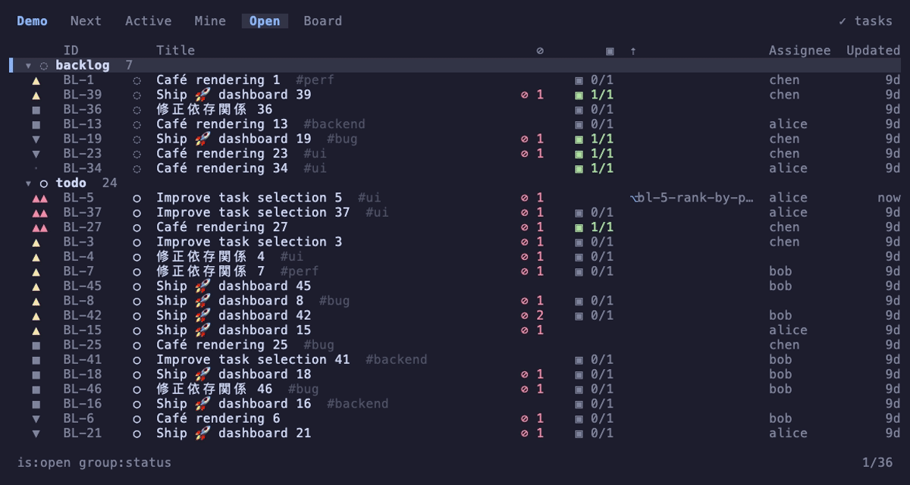



  

<h1 align="center">Backlog</h1>


[`bl`](https://github.com/brettinternet/backlog) is a keyboard-first terminal
backlog for people and coding agents. Tasks are Markdown files in Git, and every
worktree shares one live queue.

## Features

- TUI with filtering, keymap help, and quick task creation
- `--json` on every command, plus an MCP server for agents
- Query language with readiness and ranking via `bl next`
- Hooks, actions, and an event stream
- Optional claims through [Worklease](/worklease/) so agents never pick up the
  same item

## Backends

- Native Markdown files
- [Backlog.md](https://github.com/MrLesk/Backlog.md)
- [Beads](https://github.com/steveyegge/beads)
- GitHub Issues and Projects v2
- Linear
- Jira Cloud
- External adapters over JSON-RPC


