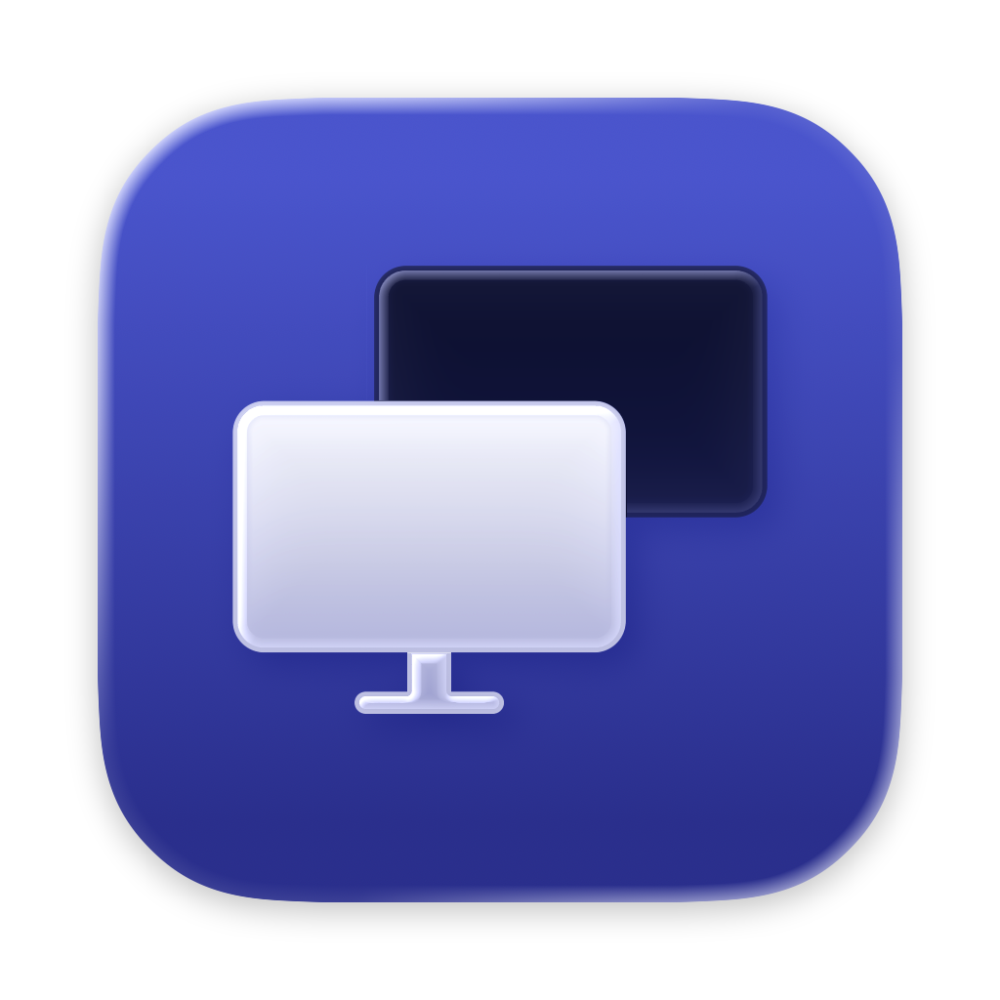



<div class="flex justify-center">
  
</div>

<h1 align="center">DisplayPanel</h1>


[DisplayPanel](https://github.com/brettinternet/DisplayPanel) started as an
experiment to learn what macOS could safely detect and control on external
monitors. Now it's become a tool I use daily to hide/show displays to switch
inputs, idle blackout for OLED protection, display sleep automation and other
experimental monitor controls.

```sh
# Black out one display after five idle minutes, then keep watching.
dp blackout --display DISPLAY_UUID --idle-after 5m --watch

# Black out every display after idle, then sleep them after 30 minutes.
dp blackout --all --idle-after 5m --sleep-after 30m --keep-displays-awake
```




